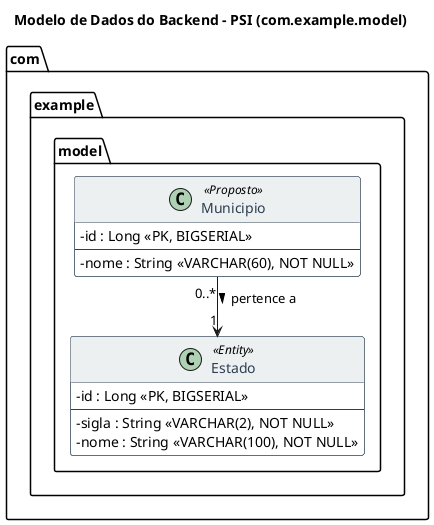

# Modelagem e Revisão de Diagramas de Classes UML (`uml-classes`)

Esta skill define o procedimento padrão e as regras de modelagem para criar, revisar, auditar, padronizar e evoluir o diagrama de classes UML em PlantUML do projeto ([`docs/modelo.plantuml`](../../../docs/modelo.plantuml)).

---

## 1. Quando Utilizar Esta Skill

Ative e siga este fluxo sempre que a solicitação envolver:
- Criação ou inclusão de novas classes, superclasses ou enums no diagrama PlantUML (`docs/modelo.plantuml`);
- Revisão de nomes e visibilidade de atributos;
- Revisão e padronização de tipos de dados e estereótipos de persistência;
- Modelagem ou ajuste de relacionamentos (associação direcionada, agregação, composição, herança/generalização);
- Definição ou revisão de cardinalidades (multiplicidades explícitas);
- Modelagem de escopo multi-tenant (*tenant-scoped*) e fronteiras de responsabilidade;
- Comparação (*diff* semântico) entre o diagrama (`docs/modelo.plantuml`), as regras de negócio (`docs/REGRAS_NEGOCIO.md`) e o código-fonte (`backend/`).

---

## 2. Etapa Obrigatória de Inspeção Prévia

**Nunca** edite o arquivo `docs/modelo.plantuml` às cegas. Antes de propor ou aplicar qualquer alteração no diagrama, consulte obrigatoriamente:

1. **Regras de Negócio:** [`docs/REGRAS_NEGOCIO.md`](../../../docs/REGRAS_NEGOCIO.md) — verifique obrigatoriedades, limites de caracteres, unicidades e regras de domínio.
2. **Contexto do Projeto:** [`docs/CONTEXTO_PROJETO.md`](../../../docs/CONTEXTO_PROJETO.md) — verifique decisões arquiteturais (ADRs), status da migração e pendências.
3. **Diagrama Atual:** [`docs/modelo.plantuml`](../../../docs/modelo.plantuml) — compreenda a estrutura, os estereótipos e as notas de decisão pendentes já registradas.
4. **Classes Existentes no Backend:** Inspecione as entidades implementadas em `backend/src/main/java/com/example/model/`, DTOs em `backend/src/main/java/com/example/dto/` e migrations em `backend/src/main/resources/db/migration/`.

---

## 3. Diretrizes de Modelagem UML / PlantUML

Ao construir ou revisar classes e relacionamentos em `docs/modelo.plantuml`, aplique rigorosamente os seguintes critérios:

### 3.1. Visibilidade e Encapsulamento (Atributos Privados)
- **Atributos Privados (`-`):** Todos os atributos de entidades e classes de domínio devem utilizar visibilidade privada explícita (`- nomeAtributo : Tipo`).
- **Configuração Visual:** Mantenha `skinparam classAttributeIconSize 0` e `hide empty methods` no cabeçalho do PlantUML para exibir explicitamente o símbolo `-` em vez de ícones gráficos.
- Separe a chave primária (`- id : Long`) dos demais atributos de negócio utilizando o separador `--`.

### 3.2. Tipos Coerentes
- Utilize os tipos Java canônicos adotados na camada `com.example.model` (`Long`, `String`, `Integer`, `BigDecimal`, `LocalDate`, `LocalDateTime`, `Boolean`), podendo complementá-los com estereótipos concisos de banco/restrição quando agregarem clareza (ex: `- sigla : String <<VARCHAR(2), NOT NULL>>`).
- Evite tipos primitivos ambíguos (`int`, `double`, `boolean`) ou tipos exclusivos de banco sem correspondência direta em Java.
- Não duplique chaves estrangeiras como atributos escalares (`- estadoId : Long`) quando o relacionamento já estiver representado por seta de associação/composição entre as classes (ou atributo de referência `- estado : Estado`), mantendo o modelo limpo e coerente.

### 3.3. Relacionamentos, Composição e Agregação
Escolha a semântica UML exata para cada ligação entre classes:
- **Composição (`*--`):** Ciclo de vida estritamente dependente, onde a "parte" não existe sem o "todo" e é removida junto com ele (ex: `Pessoa "1" *-- "1..*" Telefone : possui >`).
- **Agregação (`o--`):** Relação todo-parte em que a parte pode existir independentemente do todo.
- **Associação Direcionada (`-->` ou `--`):** Referência estrutural entre entidades independentes com rótulo de leitura claro (ex: `Municipio "0..*" --> "1" Estado : pertence a >`).

### 3.4. Cardinalidades Explícitas
- **Proibido omitir multiplicidades:** Todo relacionamento deve declarar a cardinalidade explícita em **ambas as extremidades** entre aspas:
  - `"1"` (exatamente um / obrigatório — `nullable = false`)
  - `"0..1"` (zero ou um / opcional — `nullable = true`)
  - `"0..*"` (zero ou muitos)
  - `"1..*"` (um ou muitos)
- A multiplicidade mínima (`0` vs `1`) deve refletir fielmente a obrigatoriedade definida nas regras de negócio.

### 3.5. Relacionamentos *Tenant-Scoped* (Isolamento por Tenant)
- Quando o modelo contiver entidades com isolamento por tenant/organização/clínica:
  - Identifique claramente as classes que pertencem ao escopo de um tenant (via relacionamento explícito com a entidade de Tenant ou estereótipo `<<TenantScoped>>`);
  - Garanta que associações entre entidades *tenant-scoped* respeitem a mesma fronteira de tenant (proibindo relações cruzadas entre tenants distintos);
  - Explicite se restrições `UNIQUE` (ex: `cpf`, `email`, `crp`, `sigla`, `codigo`) são globais ou restritas ao escopo do tenant (`<<UNIQUE por Tenant>>`).

### 3.6. Responsabilidades das Classes
- Cada classe deve possuir responsabilidade única, coesa e fiel ao domínio de negócio.
- Não misture dados de papéis distintos na mesma classe (ex: mantenha `Pessoa`, `Paciente`, `Psicologo` e `Usuario` com suas responsabilidades claramente delimitadas) nem inclua propriedades exclusivas de tela/DTO nas entidades de domínio.

### 3.7. Diferença entre Proposta e Implementação
- **Implementado vs. Proposto:** Diferencie visualmente o que já está implementado no código/banco do que ainda é apenas proposta de modelagem utilizando estereótipos:
  - `<<Entity>>` (ou `<<MappedSuperclass>>` / `<<Enum>>`): já implementado em `com.example.model` e no Flyway;
  - `<<Proposto>>`: modelado no diagrama, mas ainda pendente de implementação ou em migração do legado.
- **Decisões de Domínio Pendentes:** Dúvidas de modelagem (cardinalidades abertas, herança de auditoria, escopo multi-tenant) devem ser documentadas em blocos `note` no diagrama, nunca decididas silenciosamente no código.

---

## 4. Regra de Ouro: Isolamento entre Diagrama e Código

> **IMPORTANTE — REGRA DE BLOQUEIO:**
> **NUNCA altere entidades JPA (`model/`), `DTOs`, `Mappers`, `Repositories`, `Services`, `Resources`, migrations do Flyway (`db/migration/`) ou arquivos do Frontend apenas porque uma mudança foi solicitada ou realizada no diagrama `docs/modelo.plantuml`.**

Sempre que criar/alterar elementos no diagrama ou compará-lo com o código existente, siga obrigatoriamente este protocolo:

1. **Altere exclusivamente o diagrama** (`docs/modelo.plantuml`) e, quando pertinente, aponte o impacto na documentação em `docs/`.
2. **Apresente as Divergências para Aprovação (Diagrama x Código):**
   Estruture um resumo claro contendo:
   - **Apenas no Diagrama (`<<Proposto>>`):** Classes, atributos ou relacionamentos presentes no UML mas ainda não implementados no código/Flyway.
   - **Apenas no Código / Banco:** Tabelas, colunas legadas ou atributos que existem na implementação mas divergem ou não constam no diagrama.
   - **Divergências de Tipo, Visibilidade, Nome ou Cardinalidade:** Qualquer conflito entre `docs/modelo.plantuml`, `docs/REGRAS_NEGOCIO.md` e `com.example.model`.
   - **Decisões de Domínio em Aberto:** Pontos que exigem definição do usuário.
3. **Aguarde Aprovação Explícita:** Solicite a validação do usuário antes de propagar qualquer mudança do diagrama para entidades, migrations ou código.

---

## 5. Template de Referência PlantUML

